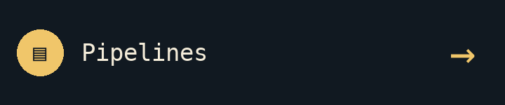
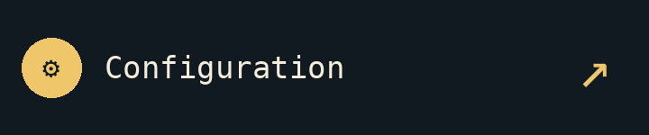
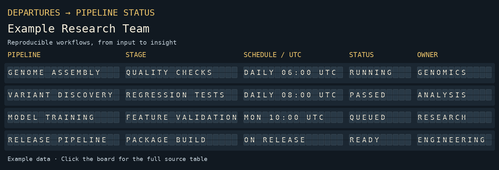

# Flight Board Tables

A GitHub Action that turns your table into an animated flight board in your README.

<!-- flight-board:start -->
<p align="center">
  <a href="demo/board.csv"></a>
  <a href="docs/configuration.md"></a>
  <a href="#quick-start"></a>
</p>

<a href="demo/board.csv"></a>

<!-- flight-board:end -->

## Quick start

**Use the Action from your own repository. No separate board repository or Python setup is needed:**

1. Copy these files:

   | Copy | Save as |
   | --- | --- |
   | [Table](starter/board.csv) | `board.csv` |
   | [Configuration](starter/flight-board-config.yml) | `flight-board-config.yml` |
   | [Workflow](starter/flight-board-workflow.yml) | `.github/workflows/flight-board.yml` |

2. Edit your table and set `team` in `flight-board-config.yml`. All columns display automatically. See [configuration](docs/configuration.md) to choose columns, protect dates from animation, or add navigation signs.
3. Commit to `main`. Open **Actions → Update flight board** to follow progress, then view your README.

The workflow adds the board at the bottom of your README. To choose its position, insert:

```html
<!-- flight-board:start -->
<!-- flight-board:end -->
```

After setup, commit table or configuration changes to refresh the board. You can also select **Actions → Update flight board → Run workflow**.

**Using a subfolder?** Keep the workflow in `.github/workflows/`. Set its `config` input to your configuration's path, and set `source` and any output paths relative to the repository root—not the configuration folder. Update the workflow's `paths` filters too. [Subfolder example](docs/configuration.md#using-a-subfolder).

**Different branch?** Update the workflow's `branches` filter.

**Nothing runs?** Check that Actions is enabled and your organization permits this Action.

**The bot cannot save changes?** It needs `contents: write`. Protected branches may require your organization's pull-request process instead of a direct push.

**Private pipeline dashboard?** Use the same three files in a private repository. Add columns such as `Pipeline`, `Lifecycle`, `Owner`, and `Updated`, with values such as `Development` or `Production`. The generated board stays in that repository. These labels come from your table; they are not inferred from workflow runs.

**Need live statuses?** The board normally reflects your table. Add the optional [workflow monitor](docs/monitoring.md) to populate it automatically.

## How it works

Your workflow calls `j3551ca/flight-board-tables@v2`. The Action reads **your** table and configuration, generates images in **your** repository, and updates **your** README. The workflow commits those changes.

The board above is just this repository's demo. Your data and images stay in your repository.

## In this repo

- `flight_board/` — the Python implementation, supplied by the Action.
- `starter/` — the three files users copy.
- `demo/` — data for the demonstration above.
- `extras/monitoring/` — optional collection of real GitHub workflow statuses.
- `docs` - documentation on adjusting settings,[automatic pipeline monitoring](docs/monitoring.md), [local use and development](docs/development.md) 

